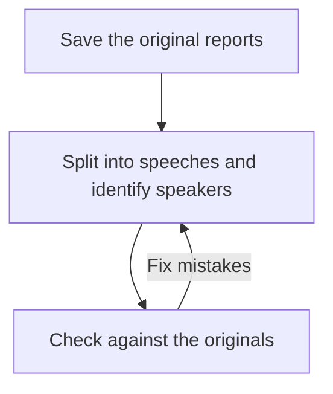
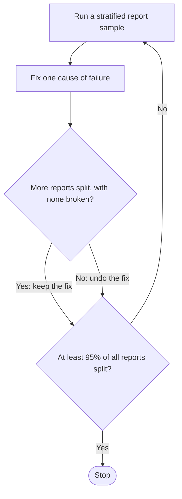
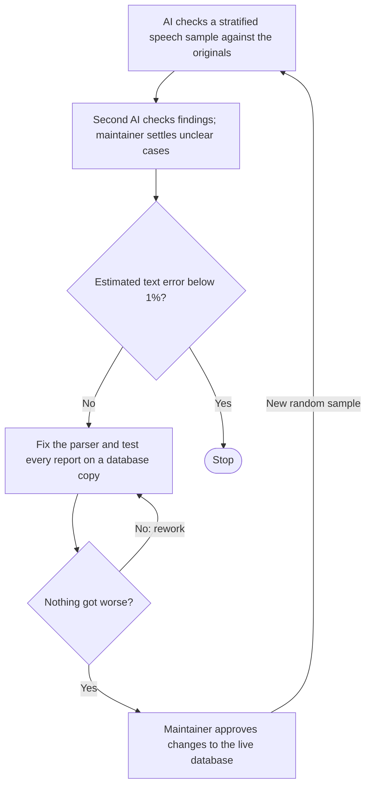

<picture>
  <source media="(prefers-color-scheme: dark)" srcset="docs/images/banner-dark.svg">
  
</picture>

This project builds a database of Singapore's parliamentary record, from the Legislative Assembly of 1955 to the present Parliament. The pipeline fetches every report from SPRS, Parliament's search system. A report is one item of business in a sitting, such as a question, a bill, or a motion. The pipeline splits each report into speeches and links each speech to the member who gave it.

The project exists so that researchers and anyone following a member's contributions can find their speeches across the record. On SPRS, each report is one page of text, and a speaker is a printed name with no link to the member.

The website built on this database is [roycehoe/hansard](https://github.com/roycehoe/hansard), live at [openhansard.sg](https://openhansard.sg).

## Scope

The project collects the record and sorts it for browsing, such as what a member spoke on and what they criticised in Parliament. The project is non-partisan on purpose and publishes no analysis of its own. Analysis that compares parties, ranks members, or traces how a member's views shifted is out of scope. A division's vote broken down by party is in scope because it counts votes without drawing a conclusion. The maintainers hold political views, as everyone does, and analysis they chose to publish would carry them. The site's colour scheme avoids party colours for the same reason. [docs/vision.md](docs/vision.md#scope) draws the line in full.

## Status

`refresh.py` runs once a day to add sittings SPRS has published since the last stored one. It adds rows, updates three columns of a Bill when a new report joins it, widens the bounds of the seat history, and never re-parses a stored report. [docs/refresh.md](docs/refresh.md) describes a run.

## Getting the data

The database is not published for download because Parliament's terms of use require written permission to reproduce its content, and the maintainers have not yet settled whether they allow a download. To ask about access, email contact@openhansard.sg.

You can build your own copy with the steps under [Setup](#setup). A full crawl sends more than 50,000 requests, 2 seconds apart, so it takes more than a day.

## What the record holds

The record runs from the Legislative Assembly before independence, through the 1st to 15th Parliaments. It holds the reports, speeches, people, and sittings, and who was present and absent at every sitting. For the dates and counts, see the [coverage page](https://openhansard.sg/coverage). Its [methods page](https://openhansard.sg/coverage/methods) has the full counts, reports by year, and known gaps. The site calls each speech row a paragraph. The site's application programming interface (API) is the only source of the dates and totals. This page doesn't copy them, because a copy here could fall out of date.

## How accurate the speaker links are

About 98% of the text sits in a speech linked to a member ([figures](docs/figures/2026-10-19-backfill-15.txt)). Most of the rest is text no member spoke, such as "Question put, and agreed to." In a sample of 1,000 paragraphs checked on 2 November 2026, no more than 0.47% of credited paragraphs named the wrong person ([methods page](https://openhansard.sg/coverage/methods)).

## How it was built

Three steps turn a report into speeches credited to members.



1. Save the original reports. The pipeline stores every report as received so it can rebuild the speeches without fetching it again.
2. Split into speeches and identify speakers. The parser splits each report at bold speaker names. Repeated rounds of testing and fixes handle reports the parser fails to split. Names are then matched to parliament.gov.sg's members and hand-kept facts, such as colonial Assembly members.
3. Check against the originals. A second loop checks samples against the source to find and fix parser errors.

[How the data was checked](#how-the-data-was-checked) describes both loops.

## How the data was checked

Two loops build and check the speeches: one to get reports to split, the other to check the resulting text against the originals. Both used a stratified sample, meaning reports or speeches drawn from different groups in the record, so the checks covered more than one part of it.

1. Split into speeches. Each round an artificial intelligence (AI) model ran a stratified sample of reports through the parser and fixed one reason some failed to split. The maintainers kept a change only if it broke nothing. The loop stopped when 99.9% of reports split into speeches ([loop log](docs/report/refine-loop.md)).
2. Check against the originals. Each round an AI read a stratified sample of about 400 speeches against the source pages. Each fix ran over every report on a copy of the database, and the maintainers shipped it only if nothing got worse. The loop stopped after five rounds, when the error bound fell below 1%, and a sixth round checked the 15th Parliament ([loop log](docs/report/speech-fidelity-loop.md)).

<details>
<summary>Split into speeches (diagram)</summary>



</details>

<details>
<summary>Check against the originals (diagram)</summary>



</details>

## How it compares

From [docs/benchmark.md](docs/benchmark.md), surveyed 18 October 2026.

| | This project | SPRS | Pair Search | sgparliament.com | Par-leh-mate |
|---|---|---|---|---|---|
| Unit of text | One speech | One page per report | One report | One turn per printed speaker | One paragraph |
| Speech linked to a member | Yes | No, a printed name only | Not stated | Yes, to a member page | By cleaned name match |
| Procedural lines | Kept apart, with no speaker | Printed in the text | Not stated | Folded into the last speaker's turn | Not stated |
| Words credited to the right person | 99.4% | Not applicable | Not measured | 95.5% | Not measured |
| Published accuracy | Figures after every rebuild, and an audit | None | Click rank only | None | None |
| API or download | Not yet | Undocumented JSON endpoints | None public | None | BigQuery, access required |

The 99.4% and 95.5% come from a check of 191 reports ([comparison](docs/report/sgparliament-comparison-2026-10-18.md)). AI models judged the sample under rules the maintainers set for this project. They saw the two sites as "Site A" and "Site B", so they couldn't tell which was which. The [checks](docs/report/sgparliament-comparison-2026-10-18.md#method-1) say how the verdicts were tested. Most of sgparliament.com's errors are presiding officers and heads of state it leaves unlinked, which this project links to the holder of the day.

The 99.4% and 95.5% credit each Addendum to the President's Address to the minister who signs it. Read as nobody's words, the figures are 98.5% and 96.8%.

## Known limits

Four limits affect the data:

- Some reports have no text. Most are the President's assent to bills from September 2012, which SPRS sends as a bill list with no report text. For the others SPRS sends no text, most often an empty text field or an error. The methods page gives the count. Every other report has its speeches.
- About 12,000 speeches have a speaker label but no link to a member. About 9,000 of them are "The Chairman" in reports that do not say who was in the chair ([decision record](docs/adr/0002-role-holder-attribution.md)). Most of the rest are collective labels such as "An hon. Member".
- Some reports still hold speeches split by an older version of the parser (the methods page gives the count).
- Speeches from the older system (Parliaments 0 to 11) carry the Hansard column they start in, as printed. 29,027 of 607,946 rows in reports with column markers have none, because the column markers do not fix it. Later speeches carry no column number.

[docs/data-dictionary.md](docs/data-dictionary.md) has the fields and more caveats, and [docs/data-loss-register.md](docs/data-loss-register.md) lists every step that drops or changes source text.

## Repository layout

| Folder | What it holds |
|---|---|
| `gateway/` | HTTP calls to SPRS and parliament.gov.sg |
| `schemas/` | Pydantic models of the API responses |
| `services/` | Pure transforms, such as report text into speeches and names into members |
| `database/` | Table definitions |
| `crud/` | Database reads and writes |
| `populate/` | Pipeline stages, which join the folders above |
| `alembic/` | Database migrations |
| `scripts/` | Diagnostics and supervised one-off writes |
| `data/` | Hand-kept reference files, such as speaker overrides and the colonial member list |
| `docs/` | Data dictionary, decision records, audits, and figures |
| `tests/` | Golden fixtures for the parser |

## Setup

Requires Python 3.12+, [Poetry](https://python-poetry.org), and Docker.

```bash
git clone https://github.com/roycehoe/hansard-scraper.git
cd hansard-scraper
poetry install
docker-compose up -d    # local PostgreSQL at the default DATABASE_URL

# The default search window is 2012 to April 2025. Widen it to the whole record.
export SEARCH_FROM_DATE=1955-01-01 SEARCH_TO_DATE=2026-10-19

# 1. Reports and speeches
python -c "from database.init import create_db_and_tables, get_session; from populate.hansard_responses import populate_hansard_responses; from populate.reports import populate_reports; from populate.speeches import populate_speeches; create_db_and_tables(); session = next(get_session()); populate_hansard_responses(session); populate_reports(session); populate_speeches(session)"

# 2. The people who speak
python scripts/scrape_speakers_by_parliament.py --commit
python scripts/load_colonial_la_speakers.py --commit
python -m scripts.load_heads_of_state --commit

# 3. Sittings, attendance, links from speeches to members, and people
python script.py

# 4. Party changes within a Parliament
python -m scripts.load_party_affiliations --commit
```

These steps come from reading the code and have not been run end to end on an empty database, so treat them as an untested starting point. The stored database also carries one-off fixes made by scripts in `scripts/`, so a rebuild will differ from it in places.

`python refresh.py` adds the sittings published since the last stored one. [docs/refresh.md](docs/refresh.md) covers its halts and alerts.

`ruff check .` lints the code and `poetry run ruff format --check .` checks its formatting. `poetry run basedpyright` type-checks it and fails only on errors that are not in `.basedpyright/baseline.json`. `poetry run pytest` runs the parser fixtures. It needs a separate PostgreSQL database named `hansard_launch` on port 5435, and `tests/conftest.py` refuses any other.

## Documentation

Six references cover the data and pipeline:

- [Data dictionary](docs/data-dictionary.md): what each table and field means, the report types, and data caveats.
- [Parsing internals](docs/parsing.md): quirks of the source HTML. Read it before changing the parser.
- [Vision](docs/vision.md): the project's goals and the current figure for each.
- [Benchmark](docs/benchmark.md): the comparison with other Singapore Hansard tools, with sources.
- [Daily refresh](docs/refresh.md): what the refresh fetches, its alerts, and its halts.
- [Decision records](docs/adr/): why the parser and the linker work the way they do.

## Data source and terms

Records come from the Parliament of Singapore's Parliament Reports search system (SPRS) and the member lists on parliament.gov.sg. The content belongs to Parliament. This project is not affiliated with or endorsed by Parliament. Parliament's [terms of use](https://www.parliament.gov.sg/terms-of-use) require written permission to reproduce its content, so check them before you republish anything the pipeline fetches.

The fetcher sends one request at a time and waits at least 2 seconds between requests, retries included. It identifies itself as `hansard-scraper (+contact@openhansard.sg)` and backs off further on HTTP 429.

## Citation

> Open Hansard (2026). *Singapore Parliamentary Record*. GitHub. https://github.com/roycehoe/hansard-scraper. Website: https://openhansard.sg

Quote speeches from the Official Report on [SPRS](https://sprs.parl.gov.sg/search/), which is the authoritative record.

## Contributing

Open an issue before you open a pull request. [CONTRIBUTING.md](CONTRIBUTING.md) says how.

## License

The code is under the [MIT license](LICENSE). The license does not cover the text of the reports, which belongs to Parliament.
