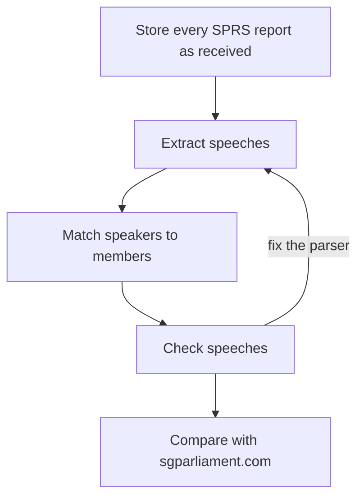
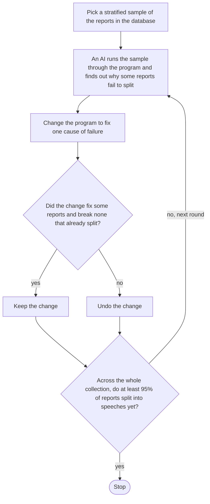
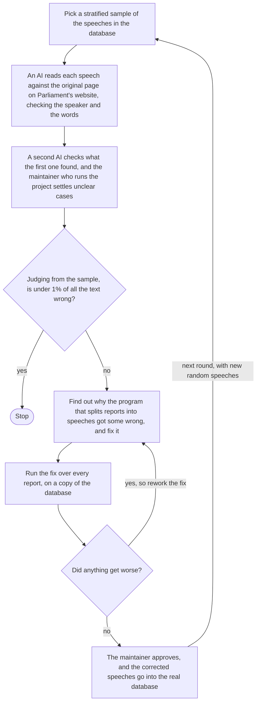

<picture>
  <source media="(prefers-color-scheme: dark)" srcset="docs/images/banner-dark.svg">
  
</picture>

A database of Singapore's parliamentary record, from the Legislative Assembly of 1955 to the present Parliament. The pipeline fetches every report from SPRS, Parliament's search system. A report is one item of business in a sitting, such as a question, a bill or a motion. The pipeline splits each report into speeches and links each speech to the member who gave it.

The website built on this database is [roycehoe/hansard](https://github.com/roycehoe/hansard), live at [hansard.fancybinary.sg](https://hansard.fancybinary.sg).

## Status

A scheduled job runs `refresh.py` once a day and adds the sittings SPRS has published since the last stored one. It only adds rows and never re-parses a stored report. [docs/refresh.md](docs/refresh.md) describes a run.

## Getting the data

The database is not published. Parliament's terms of use require written permission to reproduce its content, and the project has not yet settled whether they allow a download. To ask about access, email royceinbox@hotmail.com.

You can build your own copy with the steps under [Setup](#setup). A full crawl sends more than 50,000 requests, 2 seconds apart, so it takes more than a day.

## What the record holds

The record runs from the Legislative Assembly before independence, through the 1st to 15th Parliaments. It holds the reports, speeches, people and sittings, and who was present and absent at every sitting. For the dates and counts, see the [coverage page](https://hansard.fancybinary.sg/coverage). Its [methods page](https://hansard.fancybinary.sg/coverage/methods) has the full counts and reports by year. The site's API is the only source of these figures, so this README does not copy them.

## How accurate the speaker links are

In a check of 191 reports, 99.4% of the words here were credited to the right person, against 95.5% on sgparliament.com ([comparison](docs/report/sgparliament-comparison-2026-10-18.md)). AI models judged the sample, under rules this project wrote. They saw the two sites as "Site A" and "Site B", so they couldn't tell which was which. No person has read the sample yet. Most of sgparliament.com's errors are presiding officers and heads of state it leaves unlinked, which this project links to the holder of the day.

About 98% of the text sits in a speech linked to a member ([figures](docs/figures/2026-10-19-backfill-15.txt)). Most of the rest is text no member spoke, such as "Question put, and agreed to."

## How it was built

Work began in 2023.



1. To rebuild speeches without fetching again, every report is stored as received.
2. To get speeches, the parser splits each report at bold speaker names. The Extract speeches loop fixed the reports it failed on.
3. To know who spoke, names are matched to parliament.gov.sg's members plus hand-kept facts, like colonial Assembly members.
4. To find what the parser got wrong, the Check speeches loop read samples against the source and fixed the parser.
5. To compare, a blind test of 191 reports found 99.4% of words credited to the right person, against sgparliament.com's 95.5%.

[How the data was checked](#how-the-data-was-checked) describes both loops.

## How the data was checked

Two loops built the speeches.

1. Extract speeches. Each round an AI ran a stratified sample of reports through the parser and fixed one reason some failed to split. A change stayed only if it broke nothing. The loop stopped when 99.9% of reports split into speeches ([loop log](docs/report/refine-loop.md)).
2. Check speeches. Each round an AI read a stratified sample of about 400 speeches against the source pages. Each fix was run over every report on a copy of the database, and shipped only if nothing got worse. The loop stopped after five rounds, when the error bound fell below 1%, and a sixth round checked the 15th Parliament ([loop log](docs/report/speech-fidelity-loop.md)).

<details>
<summary>Extract speeches (diagram)</summary>



</details>

<details>
<summary>Check speeches (diagram)</summary>



</details>

## How it compares

From [docs/benchmark.md](docs/benchmark.md), surveyed 18 October 2026.

| | This project | SPRS | Pair Search | sgparliament.com | Par-leh-mate |
|---|---|---|---|---|---|
| Unit of text | One speech | One page per report | One report | One turn per printed speaker | One paragraph |
| Speech linked to a member | Yes | No, a printed name only | Not stated | Yes, to a member page | By cleaned name match |
| Procedural lines | Kept apart, with no speaker | Printed in the text | Not stated | Folded into the last speaker's turn | Not stated |
| Words credited to the right person | 99.4% | Not applicable | Not measured | 95.5% | Not measured |
| Published accuracy | Figures after every rebuild, and an audit | None | Click rank only | None | None |
| API or download | Not yet | Undocumented JSON endpoints | None public | None | BigQuery, access required |

The 99.4% and 95.5% credit each Addendum to the President's Address to the minister who signs it. Read as nobody's words, the figures are 98.5% and 96.8%.

## Known limits

- 132 reports have no text. 113 are the President's assent to bills from September 2012, which SPRS sends as a bill list with no report text. SPRS sends no text for the other 19, most often an empty text field or an error. Every other report has its speeches.
- About 12,000 speeches have a speaker label but no link to a member. About 9,000 of them are "The Chairman" in reports that do not say who was in the chair ([decision record](docs/adr/0002-role-holder-attribution.md)). Most of the rest are collective labels such as "An hon. Member".
- 66 reports still hold speeches split by an older version of the parser.
- Older-system speeches (Parliaments 0 to 11) carry the Hansard column they start in, as printed. 29,027 of 607,946 rows in reports with column markers have none, because the column markers do not fix it. Later speeches carry no column number.

[docs/data-dictionary.md](docs/data-dictionary.md) has the fields and more caveats, and [docs/data-loss-register.md](docs/data-loss-register.md) lists every step that drops or changes source text.

## Repository layout

| Folder | What it holds |
|---|---|
| `gateway/` | HTTP calls to SPRS and parliament.gov.sg |
| `schemas/` | Pydantic models of the API responses |
| `services/` | Pure transforms, such as report text into speeches and names into members |
| `database/` | Table definitions |
| `crud/` | Database reads and writes |
| `populate/` | Pipeline stages, which join the folders above |
| `alembic/` | Database migrations |
| `scripts/` | Diagnostics and supervised one-off writes |
| `data/` | Hand-kept reference files, such as speaker overrides and the colonial member list |
| `docs/` | Data dictionary, decision records, audits and figures |
| `tests/` | Golden fixtures for the parser |

## Setup

Requires Python 3.11+, [Poetry](https://python-poetry.org) and Docker.

```bash
git clone https://github.com/roycehoe/hansard-scraper.git
cd hansard-scraper
poetry install
docker-compose up -d    # local PostgreSQL at the default DATABASE_URL

# The default search window is 2012 to April 2025. Widen it to the whole record.
export SEARCH_FROM_DATE=1955-01-01 SEARCH_TO_DATE=2026-10-19

# 1. Reports and speeches
python -c "from database.init import create_db_and_tables, get_session; from populate.hansard_responses import populate_hansard_responses; from populate.reports import populate_reports; from populate.speeches import populate_speeches; create_db_and_tables(); session = next(get_session()); populate_hansard_responses(session); populate_reports(session); populate_speeches(session)"

# 2. The people who speak
python scripts/scrape_speakers_by_parliament.py --commit
python scripts/load_colonial_la_speakers.py --commit
python -m scripts.load_heads_of_state --commit

# 3. Sittings, attendance, links from speeches to members, and people
python script.py

# 4. Party changes within a Parliament
python -m scripts.load_party_affiliations --commit
```

These steps come from reading the code, and nobody has run them end to end on an empty database. The stored database also carries one-off fixes made by scripts in `scripts/`, so a rebuild will differ from it in places.

`python refresh.py` adds the sittings published since the last stored one. [docs/refresh.md](docs/refresh.md) covers its halts and alerts.

`ruff check .` lints the code. `poetry run pytest` runs the parser fixtures. It needs a separate PostgreSQL database named `hansard_launch` on port 5435, and `tests/conftest.py` refuses any other.

## Documentation

- [Data dictionary](docs/data-dictionary.md): what each table and field means, the report types, and data caveats.
- [Parsing internals](docs/parsing.md): quirks of the source HTML. Read it before changing the parser.
- [Vision](docs/vision.md): the project's goals and the current figure for each.
- [Benchmark](docs/benchmark.md): the comparison with other Singapore Hansard tools, with sources.
- [Daily refresh](docs/refresh.md): what the refresh fetches, its alerts and its halts.
- [Decision records](docs/adr/): why the parser and the linker work the way they do.

## Data source and terms

Records come from the Parliament of Singapore's Parliament Reports search system (SPRS) and the member lists on parliament.gov.sg. The content belongs to Parliament. This project is not affiliated with or endorsed by Parliament. Parliament's [terms of use](https://www.parliament.gov.sg/terms-of-use) require written permission to reproduce its content, so check them before you republish anything the pipeline fetches.

The fetcher sends one request at a time and waits at least 2 seconds between requests, retries included. It identifies itself as `hansard-scraper (+royceinbox@hotmail.com)` and backs off further on HTTP 429.

## Citation

> Royce Hoe (2026). *Singapore Parliamentary Record*. GitHub. https://github.com/roycehoe/hansard-scraper

Quote speeches from the Official Report on [SPRS](https://sprs.parl.gov.sg/search/), which is the authoritative record.

## License

The code is under the [MIT license](LICENSE). The license does not cover the text of the reports, which belongs to Parliament.
