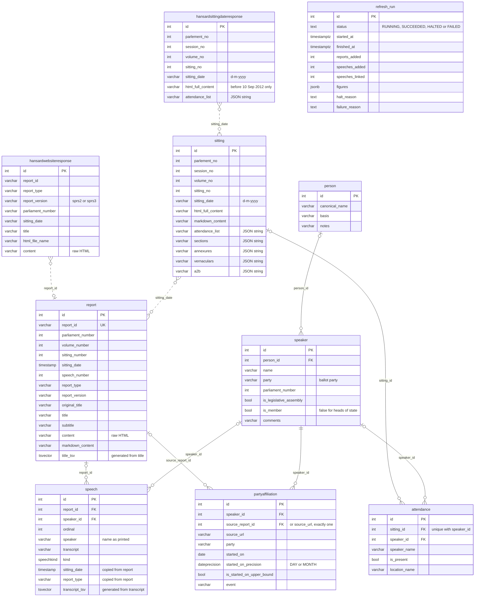

# Database

The SQLModel classes in this folder define every table the pipeline writes. Solid lines are foreign keys. Dotted lines are joins on a shared value with no foreign key behind them. Each box lists the keys and the columns most queries need. `sitting` and `hansardsittingdateresponse` hold about 60 more columns copied from the API, listed in [docs/data-dictionary.md](../docs/data-dictionary.md).

