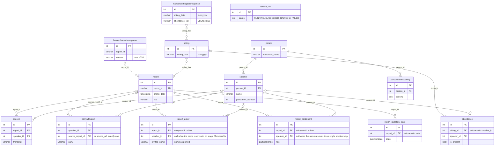

# Database

The SQLModel classes in this folder define every table the pipeline writes. Solid lines are foreign keys. Dotted lines are joins on a shared value with no foreign key behind them. Each box lists the keys and a few columns that show what the table holds. The SQLModel classes have every column, and [docs/data-dictionary.md](../docs/data-dictionary.md) describes the main tables.

